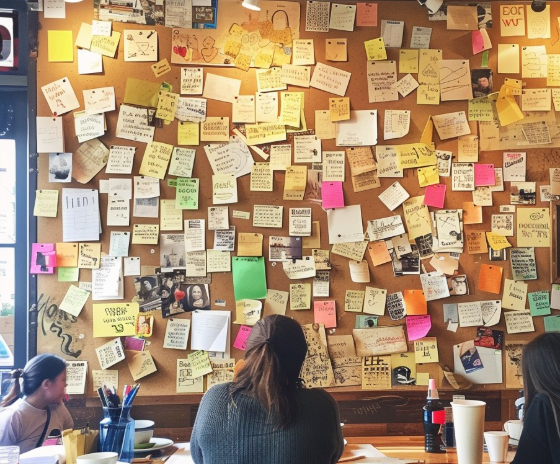

Me desperté con esa puta canción sonándome otra vez en la cabeza.

Ya iban cuatro días.

Al principio no me molestaba tanto. Era una linda canción, aunque estuviera en un idioma que apenas entendía. Uno pensaría que así sería más fácil ignorarla, pero, por alguna razón bastante estúpida, pasaba todo lo contrario. Quería entenderla.

Así que me puse a aprender el idioma.

No solamente por la canción. O al menos eso era lo que me repetía.

Aprender español ya estaba en mi lista imaginaria de cosas que algún día iba a hacer.

Aprender otro idioma.

Viajar más.

Salir a correr con regularidad.

Convertirme en una de esas personas que doblan la ropa apenas terminan de lavar.

Ya sabés, cosas imposibles.

Pero escuché esa canción y, de golpe, aprender español pasó a estar mucho más arriba en la lista.

Empecé con algunas palabras, después frases y preguntas. Entendía pedacitos, aunque todavía tenía que traducir casi todo. Unas semanas antes no habría entendido absolutamente nada. Ahora podía reconocer palabras sueltas y, a veces, hasta darme cuenta de lo que significaban sin tener que traducirlas primero.

El problema fue que, en el camino, la canción empezó a gustarme un poco más de la cuenta.

Y entonces, por razones que probablemente sea mejor no explicar, decidí que tenía que aprender a dejar de escucharla.

## Viernes

Intenté trabajar esa mañana, pero no podía concentrarme. Intenté ver algo, comí cualquier cosa, me puse a revisar lo que fuera que apareciera en el celular y, básicamente, hice de todo menos lo que tenía que hacer.

En algún momento abrí Spotify.

Ahí estaba. La canción.

Me quedé mirándola unos segundos y me dije que no la iba a poner. Después la puse igual.

La puta madre.

La escuché un rato y la corté más o menos por la mitad. Esa se había convertido en una de mis pequeñas reglas absurdas. Si no podía evitar poner la canción, por lo menos no la iba a escuchar entera.

No sé muy bien qué pretendía conseguir con eso.

Capaz que cortarla a la mitad contaba como un avance. O capaz que simplemente estaba intentando demostrarme que todavía tenía algo de control sobre el asunto.

Como sea, unos minutos después de cerrar Spotify, la canción volvió a sonar en mi cabeza.

La puta madre.

Así que, cerca de las once de la mañana, agarré la bici.

No tenía un destino en mente, lo cual suele ser una pésima manera de empezar lo que terminaría siendo un día entero arriba de una bicicleta. Solo sabía que quería ir a algún lado.

A cualquier lado, en realidad.

Andar en bici tiene una ventaja cuando tu cabeza no se quiere callar. Después de un rato, tu cuerpo está demasiado ocupado tratando de mantenerte vivo como para prestarle atención a todas las pavadas que se te cruzan por la cabeza.

Mirá el camino.

Esquivá el auto.

Cambiá de marcha.

Tomá agua.

No te lleves puesto al viejo.

*¿Y este tipo qué carajo hace caminando por la bicisenda?*

Durante un rato funcionó.

La canción desapareció.

Así que seguí pedaleando.

No estaba prestando demasiada atención a dónde iba. Empecé por ciclovías que ya conocía, después agarré calles por las que había pasado un par de veces y, al rato, terminé mirando el mapa porque ya no tenía idea de dónde estaba yendo.

Hacía calor. Un calor de la puta madre.

Estaba en Singapur, cerca del mediodía, y por alguna razón había decidido que era el momento ideal para hacer una especie de experimento psicológico conmigo mismo.

Paré en el camino para tomar agua y miré el celular. Spotify seguía ahí, obviamente, y por un segundo pensé en abrirlo.

*Ni en pedo.*

Sabía perfectamente lo que iba a pasar.

La caja de Pandora podía quedarse cerrada una horita más.

Guardé el celular en el bolsillo y volví a subirme a la bici.

Una pequeña victoria.

A primera hora de la tarde ya había llegado a la costa. El mar estaba de un azul ridículo ese día, y había familias por todos lados.

Había chicos corriendo, ciclistas que iban y venían, y gente sentada en los bancos bajo los árboles.

Personas normales que, a diferencia de mí, entendían que uno va a la playa para relajarse.

En un momento pasé al lado de un nene que estaba construyendo un castillo de arena enorme. Le estaba quedando bastante bien. Había hecho murallas, varias torres puntiagudas y una torre más alta en el medio. No sé cuánto tiempo llevaba con eso, pero con el agua azul de fondo, el castillo parecía demasiado perfecto para una tarde cualquiera en la playa.

Por unos segundos, capaz que era el lugar más feliz del mundo.

Seguí pedaleando, mirando para todos lados más de lo que debería, cuando un nene con una remera de Mickey Mouse se metió en la bicisenda. El padre lo agarró y lo apartó justo antes de que llegara.

Parece que hasta Mickey me quería matar esa tarde.

Me dio risa pensarlo y seguí.

Y así fue pasando la tarde. Cada tanto, cualquier pavada me hacía acordar de la canción.

Una palabra en un cartel.

Algo que alguien llevaba puesto.

Un chiste tonto que se me vino a la cabeza.

A veces, absolutamente nada.

Ni siquiera hacía falta un motivo.

La canción simplemente decidía que era hora de volver a sonar en mi cabeza.

Y cada vez que pasaba, pedaleaba un poco más lejos.

Más adelante, por la costa, pasé junto a unos trabajadores que estaban descargando cajones de agua embotellada de un camión. Había decenas de cajones apilados al costado del camino.

Por alguna razón, miré todas esas botellas y pensé que eran un montón de cosas para mantener cerradas.

Esperaba que a nadie se le ocurriera tirarlas al Pacífico.

En fin.

En algún momento, probablemente después de pasar por la segunda localidad, empecé a preguntarme qué estaba haciendo exactamente.

----------------------------------------------

Hay una palabra que la gente suele usar cuando no podés dejar de pensar en algo.

**Obsesión.**

Nunca me gustó esa palabra. Hace que el cariño suene como una enfermedad, como si encariñarte demasiado con algo significara automáticamente que hay algo malo en vos.

No sé.

Capaz por eso estaba ahí afuera. Un poco de distancia no podía venir mal.

Yo prefería **desapego**.

Sonaba más sano. Más maduro. Muy psicológico.

Aparentemente, la manera de conseguirlo era cruzar la isla en bicicleta, bajo el sol del mediodía, hasta que la piel se me empezara a cocinar.

Una conducta sumamente saludable.

Así que seguí.

Para cuando empezó a caer la tarde, ya había cruzado dos localidades y estaba bastante metido en una tercera. No me acuerdo exactamente cuándo empezaron a quejarse las piernas. Seguramente varias horas antes de que finalmente decidiera hacerles caso.

Cerca de las cinco o seis de la tarde, por fin paré en una cafetería.

Necesitaba cafeína. O azúcar. O suero por vía intravenosa.

Lo que fuera, en realidad.

Dejé la bici afuera y entré. Había bastante gente, pero el lugar no estaba lleno. Algunos estaban trabajando con sus notebooks, otros charlaban tomando café, y había gente sentada en las mesas de afuera, a pesar de que adentro había aire acondicionado a unos tres metros de distancia.

Pedí un café.

Mientras esperaba, me acerqué al otro extremo del mostrador, donde entregaban las bebidas. Me puse a mirar alrededor porque no tenía otra cosa que hacer, y ahí vi un panel enorme colgado en una de las paredes.

Estaba lleno de fotos y notas escritas a mano.

Me acerqué.

Algunas parecían reseñas. Otras eran mensajes que la gente había dejado porque sí. Había saludos de cumpleaños, agradecimientos, chistes, dibujitos y notas que claramente estaban dirigidas a personas que no estaban ahí.

Algunas eran para amigos o familiares. Otras, claramente, para personas a las que querían.

Había chistes internos que probablemente no significaban absolutamente nada para nadie, salvo para dos personas en algún lugar del mundo.

Me quedé unos minutos leyéndolas.

En una esquina del panel había un pequeño soporte con papelitos en blanco de distintos colores y tamaños. Al lado había un marcador.

Y la canción volvió a sonar en mi cabeza.

La puta madre.

Agarré uno de los papelitos y después el marcador.

*Un café para Chiz.*

Ah, cierto. La realidad.

Agarré mi café y salí. Había algunas mesas vacías afuera, así que elegí una y me senté.

Delante de mí había un café.

Y un marcador.

Y un papelito.

----------------------------------------------

Me quedé sentado un rato.

La canción seguía sonando, aunque ya no tan fuerte. Capaz que andar en bici había servido de algo. O capaz que mi cerebro estaba demasiado cansado para seguir subiéndole el volumen.

Y, por razones que en ese momento me parecían perfectamente lógicas, empecé a preguntarme qué tan lejos podía viajar un café antes de enfriarse.

¿De una punta a otra de una ciudad?

¿De un país entero?

¿A través del Pacífico?

Once husos horarios, quizá.

Un viaje bastante estúpido para un café.

Seguro llegaría frío.

Me reí de solo pensarlo.

Después me lo tomé yo.

## Se acabaron los caminos

Podría haber vuelto a casa después de eso.

De hecho, probablemente debería haberlo hecho.

Ya estaba bastante avanzada la tarde. Llevaba horas pedaleando y estaba gastando casi toda la energía que me había dado el café en convencer a mis piernas de que todavía no habíamos terminado.

Pero volver a casa significaba parar. Y parar significaba silencio.

Y últimamente el silencio era peligroso, porque era justamente cuando la canción sonaba más fuerte.

Así que me subí otra vez a la bici.

De a poco, la tarde fue dando paso a la noche. El calor se volvió un poco más soportable, los edificios empezaron a iluminarse y la gente en las calles ya no era la misma. La mayoría volvía del trabajo a su casa, mientras yo, al parecer, intentaba averiguar cuántos kilómetros hacían falta para alcanzar la iluminación emocional.

Todavía no tenía una respuesta.

Más tarde, hice una parada que no tenía planeada para comprar algo de comer. Me acuerdo de haberme quedado mirando el menú más tiempo del necesario.

Uno de los sándwiches era de una marca llamada *Andes*.

Me quedé mirándolo unos segundos más de lo razonable.

Después pedí otra cosa.

Sin ningún motivo en particular.

En fin.

Salí del local, me subí otra vez a la bici y seguí pedaleando.

Hubo momentos en los que me olvidé por completo de la canción.

Diez minutos. Veinte. Capaz que más.

Esas eran las partes buenas.

Me fijaba en el camino, en el viento, en las luces y en los sonidos a mi alrededor. Empezaba a pensar en el trabajo o en algo que tenía que hacer al día siguiente.

Entonces me daba cuenta de que no había pensado en la canción.

Lo cual, naturalmente, me hacía pensar en la canción.

Brillante.

Crucé otra localidad.

Después, otro tramo de camino.

Para entonces, mis piernas ya habían dejado de negociar conmigo. Las pantorrillas llevaban rato quejándose y yo hacía todo lo posible por ignorarlas.

Aun así, seguí.

Creo que una parte de mí pensaba que tenía que existir alguna distancia mágica a partir de la cual los recuerdos dejaran de tener jurisdicción.

Diez kilómetros.

Veinte.

Cincuenta.

Cien.

Quizá al otro lado de un océano.

Pero resulta que al cerebro humano le importa una mierda la geografía.

Cerca de las nueve de la noche, el camino por fin se terminó.

No metafóricamente. Literalmente.

Ya no quedaba ningún lugar al que tuviera sentido ir.

Me quedé ahí un rato con la bici, mirando hacia adelante.

*Y bueno. La puta madre.*

Si el camino hubiera seguido, sinceramente creo que yo también habría seguido.

Quizá hasta medianoche. Quizá hasta el sábado. Quizá hasta el domingo.

Quizá hasta encontrar, sin querer, el camino hacia el Pacífico.

No sé.

Al final, di media vuelta.

## Paradas de colectivo

Cuando por fin llegué a casa, me dolía todo.

Las piernas. La espalda. Los hombros. La cara. La cabeza. Hasta partes de mi cuerpo que ni sabía que participaban en el ciclismo habían presentado quejas.

Me duché, me cambié de ropa y terminé tirado en el piso de mi habitación.

No en la cama. En el piso.

*No preguntes.*

Me quedé un rato mirando el techo.

La habitación estaba en silencio.

Y, curiosamente, mi cabeza también.

Me acuerdo de haber pensado que quizá lo había conseguido. Que capaz que había funcionado de verdad.

Durante varias horas del recorrido, la canción había sonado más bajito. Incluso hubo tramos en los que no la escuché para nada.

Quizá mañana iba a estar mejor. Quizá al día siguiente, mejor todavía.

Tal vez algún día se convertiría en una de esas canciones que me sé de memoria, pero que ya no necesito poner.

Cerré los ojos.

Entonces la canción volvió a sonar.

Fuerte.

Mucho más fuerte que antes.

La puta madre.

Parecía venir de todos lados.

Las paredes. El techo. El aire acondicionado. Hasta por debajo de la puerta.

Cada maldito rincón de la habitación parecía conocer la melodía.

Me di vuelta.

Seguía ahí.

Agarré el celular.

Spotify. *No.*

Lo dejé.

Unos minutos después, lo agarré otra vez.

Spotify. *Por favor, no.*

Ya no aguantaba estar en la habitación.

Así que me fui.

Decidí que esa noche iba a dormir en otro lado.

Metí algunas cosas en un bolso, salí y me tomé un colectivo. Me senté junto a la ventana y miré cómo pasaba la ciudad entre destellos de luces blancas y amarillas.

Pero la canción me siguió.

Obvio que sí.

En algún momento, entre una parada y otra, la canción empezó a sonar tan fuerte en mi cabeza que finalmente dejé de luchar contra ella.

Hay cosas de las que podés escapar corriendo y, supongo, otras de las que también podés escapar pedaleando. Pero hay otras que cruzan varias localidades con vos, se sientan a tu lado en el colectivo y te siguen hasta cualquier habitación que elijas para dormir esa noche.

Estaba cansado. Cansado de la puta madre.

*Solo quiero soltar. Por favor.*

Y entonces me cayó todo encima.

## Cuatro días después

Me enfermé. Obvio que sí.

Parece que pedalear diez horas bajo el sol tiene consecuencias.

¿Quién lo hubiera dicho?

Tenía los brazos bastante quemados por el sol, la cara hecha un desastre, y después llegaron la tos y la gripe. Durante varios días casi no salí de casa. Me la pasé sintiendo lástima por mí mismo y reconsiderando todas las decisiones que había tomado desde, más o menos, el día en que nací.

Pero mientras estaba enfermo pasó algo raro.

La canción empezó a sonar más bajito.

Seguía ahí cuando me despertaba. Las mañanas solían ser lo peor.

Había unos segundos después de abrir los ojos en los que mi cerebro todavía no terminaba de despertarse. Todo estaba en silencio.

Entonces me acordaba.

Y ahí estaba. La canción.

A veces agarraba el celular, abría Spotify, buscaba *esa canción* y la ponía.

Al principio, escuchaba casi toda la canción antes de cortarla.

Después, la mitad.

Después, menos.

Todavía había días en los que perdía la discusión conmigo mismo y la dejaba sonar entera.

Bueno. Mañana empiezo de nuevo.

Con el tiempo, cortarla por la mitad dejó de parecer una enorme demostración de autocontrol. Podía escuchar el principio y simplemente decidir que no necesitaba escuchar el resto.

Hasta que una mañana no la puse.

Recién a la hora del almuerzo me di cuenta de que ese día tampoco había sonado en mi cabeza.

Ni una sola vez.

Me reí.

Porque, naturalmente, darme cuenta de que no había pensado en la canción hizo que inmediatamente volviera a pensar en ella.

*Brillante.*

Pero algo había cambiado.

La canción parecía más lejana, como música que llegaba desde otro departamento. Todavía podía escucharla si me detenía a prestar atención, pero ya no tenía ganas de hacerlo.

No la había olvidado. Simplemente ya no necesitaba seguir poniéndola.

Capaz que eso era el desapego.

## Sigue sonando

Volví a subirme a la bici unos días después.

No para otra salida de diez horas.

Soy un idiota, pero parece que algo puedo aprender.

Todavía me estaba recuperando de las quemaduras del sol, así que esperé hasta más tarde. Hacía mejor tiempo y, esta vez, por lo menos tenía una idea de adónde iba.

Me puse los auriculares y abrí Spotify.

Por un segundo, vi la canción ahí.

La ignoré y elegí algo conocido. Algo seguro.

Después empecé a pedalear.

Sonaron unas cuantas canciones mientras avanzaba. Después otra. Y otra.

Ya no prestaba demasiada atención a lo que elegía Spotify. Pensaba en el camino, miraba a la gente pasar y me preguntaba qué iba a comer más tarde.

Cosas normales.

Entonces Spotify hizo lo que hace Spotify.

Empezó a sonar la canción.

*Esa canción.*

Por un segundo, los dedos se me fueron solos hacia el botón para pasarla.

Pero me detuve.

La dejé sonar.

El camino se extendía frente a mí. Árboles a un lado, el mar asomándose entre ellos y, de vez en cuando, algún ciclista que venía en sentido contrario.

Y ahí estaba otra vez.

La misma canción que llevaba días intentando no escuchar. La que me había seguido por varias localidades, hasta una cafetería, en un colectivo y, de alguna manera, al otro lado de un océano que en realidad nunca había cruzado.

Sonaba distinta.

O capaz que el distinto era yo.

Pensé en pasarla, pero no lo hice.

Así que seguí pedaleando y la dejé sonar.

Todavía no entendía todas las palabras.

Pero entendía más que antes.