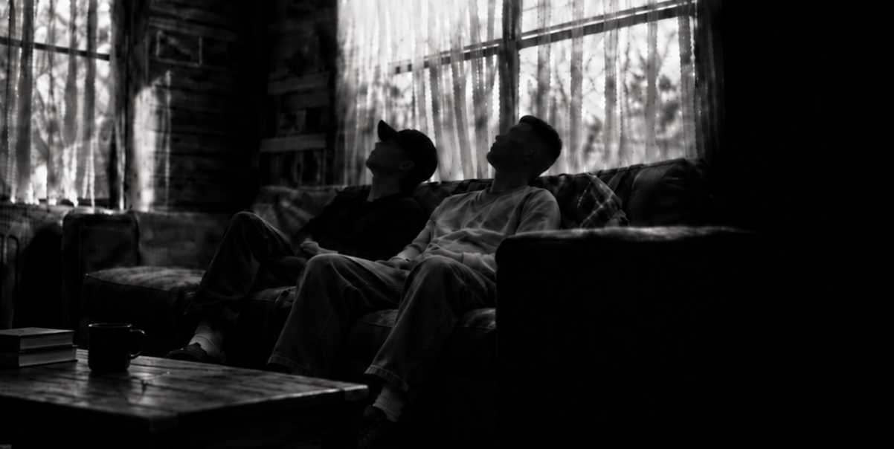

Otra vez estaba mirando el techo.

No tenía nada particularmente interesante.

Pintura blanca. Una sombra tenue de la luz que entraba por la ventana. Una pequeña grieta cerca de una esquina que había notado meses atrás y con la que no pensaba hacer absolutamente nada.

Aun así, algunas noches podía pasarme veinte minutos mirándolo. Quizá una hora.

El hombre sentado en el otro extremo del sillón se acomodó un poco.

Llevaba tanto tiempo sentado ahí que el vaso que tenía en la mano ya estaba casi vacío. Tenía una pierna cruzada sobre la otra, con aire despreocupado, y la cabeza apoyada contra el respaldo. Durante los últimos minutos, él también había estado mirando el techo.

Tal vez estaba intentando entender qué era lo que yo veía ahí arriba.

*“Estás pensando en ella otra vez.”*

“No.”

*“Claro.”*

“Estoy pensando en el techo.”

Giró la cabeza hacia mí.

Lo miré.

“Dejame de joder.”

Volví a mirar hacia arriba.

Durante un rato, ninguno de los dos dijo nada.

Entonces preguntó:

*“¿Qué tiene de especial?”*

Suspiré.

“Siempre empezás con las preguntas fáciles.”

*“¿Es linda?”*

Levantó una ceja.

*“¿Y?”*

Me quedé pensando.

“Tiene una forma de responder las cosas.”

Esperó.

*“Eso no significa absolutamente nada.”*

“Ya sé.”

*“Entonces explicámelo.”*

“Ewan ko.”

*“¿Qué?”*

“Quiero decir que no sé muy bien cómo explicarte cómo es ella.”

*“Intentá.”*

Me incorporé un poco.

“A veces digo alguna estupidez solo para molestarla. Y antes de que me conteste siquiera, ya sé lo que está haciendo.”

*“Nunca viste lo que está haciendo.”*

“Ya sé.”

*“Estás mirando palabras en una pantalla.”*

“Ya sé.”

*“No podés ver cómo reacciona alguien a través de un mensaje.”*

Me quedé callado un momento.

“A veces sí puedo. A veces puedo ver su sonrisa a través de la pantalla.”

Se rió. Yo no.

*“¿En serio le dijiste eso?”*

“Sí.”

*“¿Y todavía te habla?”*

“De vez en cuando.”

Levantó las cejas.

*“Me parece que hay una historia detrás de eso.”*

“Una larga.”

Se acomodó más profundamente en el sofá.

*“Tenemos tiempo.”*

## Sin señales de alerta

Conocí a una chica en un juego.

No en la oficina.

No en la cafetería donde siempre pido comida.

No en una librería.

No en una estación de tren.

No porque algún amigo en común pensara que nos llevaríamos bien.

Ninguna de las formas normales.

Un juego de celular. Un puto juego de celular.

*“Qué romántico.”*

“Callate.”

*“Seguí.”*

Su nombre no era realmente Panterina, y el mío tampoco era Francisco.

Esa era una de las cosas extrañas de aquel lugar. Todos llegaban usando nombres que no eran los suyos. Pequeñas islas. Alianzas. Personas repartidas por todo el planeta, fingiendo durante unas horas al día que recolectar recursos y mandar diminutas tropas por un mapa congelado eran asuntos de importancia internacional.

Y en medio de todo eso estaba ella.

Al principio, era un nombre más en el chat. Hasta que dejó de serlo.

*“¿Cómo?”*

“Ewan ko.”

*“¿Otra vez?”*

“Ya te dije. Ese es el problema.”

Las cosas rara vez avisan mientras están pasando. No apareció ningún mensaje en mi pantalla que dijera:

**ADVERTENCIA: ESTA PERSONA ESTÁ A PUNTO DE CONVERTIRSE EN UN PROBLEMA. PROCEDA CON PRECAUCIÓN.**

Y si hubiera aparecido, probablemente igual habría apretado **Aceptar**.

*“Por lo menos sos consciente de lo que hacés.”*

“Apenas.”

Empezamos a hablar. O, mejor dicho, creo que yo empecé a hablarle.

A veces durante unos minutos. A veces durante horas.

A veces empezábamos hablando de absolutamente nada y, de alguna manera, terminábamos en algún lugar al que ninguno de los dos había planeado llegar.

Comida.

Sueño.  

Países.  

Estudios.  

Trabajo.  

Pelo.

Chistes estúpidos.

Cosas que habíamos hecho ese día.

Palabras en distintos idiomas.

Por qué *Ciao* aparentemente significaba lo que a ella se le daba la gana.

*“Ciao significa adiós.”*

“Ya sé.”

*“Y hola.”*

“Aparentemente.”

Se rio.

*“Ella te corrigió, ¿no?”*

“Varias veces.”

*“¿Tenía razón?”*

“Eso no viene al caso.”

Había otras cosas.

Una referencia a algo de lo que habíamos hablado semanas atrás.

Un chiste estúpido que, de alguna manera, había sobrevivido lo suficiente como para volver a aparecer.

Palabras capaces de traer una conversación entera del pasado de vuelta al presente.

Pequeñas referencias.

Cosas que probablemente parecían completamente normales para cualquier otra persona.

Y después estaba su inglés. Sonreí.

El hombre a mi lado se dio cuenta.

*“¿Qué?”*

“Solía molestarla por su inglés.”

Se rio, *“¿Tan malo es?”*

“Una vez le dije que su inglés era malo.”

*“Un encanto lo tuyo.”*

“Creo que en un momento estuve a punto de hacerle un comentario todavía peor sobre su inglés, pero por suerte me contuve.”

Se quedó mirándome, *“Ella es argentina.”*

“Ya sé.”

*“En Argentina.”*

“Sí.”

*“Y el inglés ni siquiera es su lengua materna.”*

“Soy consciente.”

*“¿O sea que estabas a punto de criticarle el inglés mientras ella hablaba tu idioma?”*

“Cuando lo explicás así, quedo como un pelotudo.”

*“Y el inglés tampoco es tu lengua materna.”*

“Ya sé.”

*“Qué caradura.”*

“¿Terminaste de hacerme quedar como un pelotudo?”

*“Lo dijiste vos, no yo.”*

“Bueno, capaz se ríe cuando lea esto.”

Se detuvo. Lentamente, giró la cabeza hacia mí.

*“¿Cuando lea esto?”*

Me quedé mirando el techo. “¿Hmm?”

*“Dijiste ‘cuando lea esto’.”*

“¿Eso dije?”

*“Sí.”*

Siguió mirándome.

Sonreí.

“Tal vez por eso toda esta página está escrita en español, sin traducción al inglés.”

Hubo un breve silencio.

*“Pará. ¿Qué?”*

“Nada.”

*“¿Estás escribiendo todo esto?”*

“No.”

*“¿Entonces de qué página estás hablando?”* 

“Para futuras conversaciones.”

Se quedó mirándome un segundo más y después negó con la cabeza.

*“Sos un puto raro.”*

## De dos a cinco

Había cosas de ella que empecé a recordar sin proponérmelo.

San Juan. La siesta. De dos a cinco.

Una ciudad entera aparentemente capaz de decidir, de común acuerdo, que la tarde podía esperar.

También fui conociendo cosas sobre sus estudios. El profesorado.

Lo que le molestaba.

Lo que la hacía reír.

La forma en que podía decir algo completamente normal y, de alguna manera, yo seguía recordándolo días después.

Nada extraordinario. Esa era la parte difícil de explicar.

La gente espera que las razones estén a la altura de los sentimientos.

Si alguien se vuelve importante para vos, la gente espera que haya pasado algo extraordinario. Algo como:

Haber navegado a bordo del *Trinidad* a través de un océano entero.

O haber cruzado toda una cordillera, desde Cuyo hasta Chile.

Algo tan enorme que cualquiera que escuchara la historia pudiera asentir y decir: *Por supuesto.*

Pero a veces alguien se vuelve importante mientras te cuenta a qué hora duerme la siesta.

A veces es la forma en que responde una pregunta estúpida.

La forma en que dice hola.

El hecho de que quieras saber qué va a decir después.

*“O sea que es graciosa.”*

“Mucho.”

*“¿Inteligente?”*

“Sí.”

*“¿Interesante?”*

“Si no lo fuera, no seguiría mirando este puto techo.”

Sonrió. *“Te olvidaste de hermosa.”*

“No me olvidé.”

## Técnicamente, mentí

Una vez le dije que le quedarían bien los rulos.

*“¿Ah, sí?”*

“Sí.” Me reí un poco.

*“¿Entonces qué es lo gracioso?”*

“En realidad, le mentí.”

*“¿Le mentiste sobre su pelo?”*

“No. La mentira fue hacer que pareciera que el peinado importaba. Creo que se vería bien con casi cualquier cosa.”

Me acordé de otra ocasión.

Había cambiado su foto de perfil en el juego. Le dije que la foto estaba linda. Que había sido una buena elección.

“Eso también fue mentira.”

*“¿La foto no estaba linda?”*

“No. Me pareció hermosa. Pero decir que la foto estaba linda me pareció más seguro.”

Me miró un segundo.

*“O sea que básicamente te la pasás mintiéndole a esta chica.”*

“Solo cuando parece que decir la verdad me va a meter en problemas.”

## Sin necesidad de magia

En algún momento, dejé de abrir el juego porque me interesara el juego. Lo abría para ver si ella estaba ahí.

Probablemente debería haberme preocupado antes por esa diferencia.

*“¿Qué sabías realmente de ella?”*

“Mucho.”

*“No. Me refiero a qué sabías de ella de verdad.”*

“No tanto como me hubiera gustado. Pero aprovechaba cada oportunidad que tenía para conocerla un poco más.”

Esa era la parte extraña. Nunca antes había tenido que pensar tanto en lo que realmente significaba conocer a alguien.

Ya había estado cerca de otras personas.

Había visto cómo la atracción se convertía en apego, cómo ese apego se transformaba en algo más grande y cómo, al final, ese algo también terminaba.

Y también había pasado por esas horribles etapas intermedias en las que sabías que algo se estaba muriendo mucho antes de que cualquiera de los dos tuviera el valor de decirlo.

Con el tiempo, había visto cómo personas que alguna vez ocuparon la mitad de mis pensamientos se convertían en simples nombres que podía recordar sin sentir nada que doliera.

No era la primera vez que pasaba por algo así.

Sin embargo, normalmente había algo concreto que podía señalar. Algo que realmente había visto o vivido.

Pequeñas cosas que aprendés de alguien simplemente por estar cerca.

Recuerdos que existían fuera de una pantalla.

Sabías cómo se veía alguien corriendo para alcanzar el colectivo después de haberse despertado tarde, con apenas una galletita para desayunar camino a la universidad.

Qué tan rápido caminaba.

Qué hacía con las manos cuando estaba nervioso.

Si estar sentado en silencio a su lado se sentía tranquilo o incómodo.

*“¿Y con ella?”*

“Casi nada.”

*“¿Nunca estuviste sentado frente a ella?”*

“No. Las probabilidades de que eso pase son astronómicamente bajas.”

*“¿Nunca caminaron por la misma calle?”*

“No.”

*“¿Nunca estuviste parado a su lado esperando que cambiara el semáforo para cruzar la calle?”*

“No.”

*“No sabés qué tan rápido camina.”*

“No.”

*“¿Nunca le tocaste la mano?”*

“No.”

*“No sabés cómo son los espacios entre sus dedos.”*

“No.”

*“No sabés cómo suena su risa a un metro de distancia, en lugar de escucharla a través de un teléfono.”*

“Bueno, una vez sí la escuché reír. En un mensaje de voz.”

Levantó la cabeza.

*“Entonces explicámelo.”*

“¿Qué?”

*“¿Por qué ella?”*

Ahí estaba. Esa pregunta. Ya la había escuchado antes.

Una vez, o quizá dos.

¿Por qué alguien a quien nunca había conocido en persona?

¿Por qué alguien que nunca había estado en el mismo lugar que yo?

¿Cómo podía alguien que nunca había caminado a mi lado por la misma calle tener semejante efecto en mí?

“Ewan ko.”

*“Otra vez esas palabras molestas.”*

“Estoy tratando de responder esa pregunta.”

*“¿Y?”*

“Y todas las respuestas suenan estúpidas.”

*“A ver, probá conmigo.”*

Me quedé pensando.

Tal vez la respuesta más sencilla era que no me había encariñado con alguien que estuviera a un metro de distancia.

Me había encariñado con una presencia.

Una forma de pensar. Una forma de responder.

Una persona que se había vuelto reconocible por su manera de usar los signos de puntuación y por el momento en que respondía.

Aprendí a reconocer cómo se veía su diversión sin verle la boca.

A veces podía darme cuenta de cuándo estaba molesta sin verle los ojos, lo cual, sinceramente, es una estupidez.

A veces leía algo que había escrito y podía imaginar exactamente cómo lo habría dicho.

Tal vez eso era lo que quería decir cada vez que le decía que podía ver su sonrisa a través de la pantalla.

No literalmente.

Era simplemente que había empezado a reconocer dónde vivían las sonrisas entre las palabras.

“Creo que esa es la parte que no puedo explicar”, dije.

*“¿Cuál?”*

“Hay tantas cosas de ella que no sé.”

*“Un montón, por lo visto.”*

“Exacto. Y, de alguna manera, las cosas que sí sé fueron suficientes.”

No respondió. Continué.

“No sé cómo sería caminar a su lado. Si hablaría todo el tiempo o se quedaría callada. No sé esas cosas. Pero, de alguna manera, empecé a imaginar pequeños momentos así.”

*“¿Como cuáles?”*

“Nada impresionante.”

*“¿Por ejemplo?”*

“Un café.”

*“¿Eso es todo?”*

“Estar sentados en algún lugar. Ella quejándose de algo. Yo molestándola a propósito. O quizá ella molestándome a mí. Verle la cara justo antes de que diga algo sarcástico. Escucharla reír sin una pantalla entre nosotros.”

*“O sea, básicamente, cosas cotidianas.”*

“Sí. Y, de alguna manera, esas son peores.”

*“¿Por qué?”*

“Porque las fantasías ridículas son fáciles de descartar. Todo lo que requiere magia pertenece a Hogwarts. Sabés que nunca va a pasar, así que es fácil reírte de eso y seguir adelante.”

*“¿Y las cosas cotidianas?”*

“No necesitan magia.”

Volví a mirar el techo.

“Y la puta madre, parecen posibles.”

## Todavía hay un océano

Claro que algo fuera posible no significaba que fuera realista.

Lo sabía. Creeme.

Sabía perfectamente cómo eran las cosas.

Países. Distancia. Husos horarios. El momento. Las circunstancias.

Un océano de por medio, tan grande que tiene hasta su propio puto nombre.

Y el océano ni siquiera era todo el problema.

Había otras cosas. Cosas que no encajaban tan fácilmente en una lista. Cosas que no desaparecerían simplemente porque el océano dejara de estar ahí.

Después de todo, eran dos historias diferentes. Dos personas completamente distintas, cada una con su propia vida mucho antes de que siquiera empezaran a mandarse mensajes.

Y algunas cosas no eran tan simples como comprar un pasaje de avión o, qué sé yo, conseguir una visa.

Hay verdades que no se vuelven más ciertas solo porque las digas en voz alta.


## Ausencia

Había distancia, y después estaba la *distancia*.

*“¿Entonces dejaste de hablarle por un tiempo?”*

“Ella me lo pidió.”

*“Eso no fue lo que te pregunté.”*

“No le mandé mensajes.”

Pero eso no significaba que hubiera dejado de buscarla.

Borré el juego. Después, con el tiempo, volví a instalarlo.

Después intenté no entrar a mirar. Y terminé mirando.

Me decía que mañana pensaría menos en ella.

Pero el mañana se negaba a cooperar, una y otra vez.

Lo extraño de extrañar a alguien es que, por lo general, no parece algo dramático.

Seguís trabajando.

Seguís comiendo.

Salís.

Hablás con gente.

Corrés.

Andás en bicicleta.

Te reís.

Seguís funcionando.

Hasta podés pasarte un viernes entero andando en bicicleta sin ningún motivo en particular y después enfermarte también.

Entonces pasa algo gracioso y tenés una historia buenísima para contar.

*Me pregunto si a ella le—*

No.

El mundo sigue funcionando perfectamente bien.

---

Esas semanas sin ella no fueron catastróficas.

Fueron simplemente malas. Tres semanas malas.

Lo suficientemente largas como para empezar a acostumbrarme a la posibilidad de que quizá nunca volviera a hablar realmente con ella.

Finalmente, volví al juego en serio.

Y la puta madre, un simple *“Hey you”* borró por completo esas tres semanas malas.

*“Estás sonriendo.”*

“No estaba sonriendo.”

*“Ahora sí.”*

“Callate.”

*“Tres semanas intentando olvidarla, ¿eh?”*

“Sí.”

*“¿Y solo hicieron falta dos palabras?”*

Dudé un instante.

“Por un momento, me olvidé de que siquiera lo estaba intentando.”

## Una palabra tan pequeña

Cuando empezamos a hablar de nuevo, aprendí las reglas.

O al menos lo intenté.

Hablar con normalidad.

No convertir cada conversación en algo serio.

No buscarle un significado especial a cada chiste.

No confundir las cosas.

Si ella dice *amigo*, creerle.

Me miró de reojo.

*“¿Amigo?”*

“Sí.”

*“Odiás esa palabra.”*

“No la odio.”

*“Acabás de poner la misma cara que pone alguien cuando muerde un limón.”*

“Entiendo lo que significa esa palabra.”

*“Eso no fue lo que te pregunté.”*

En fin, aprendí a mantenerme de mi lado.

*“¿Y realmente lo hiciste?”*

“Sí. Estoy aprendiendo a hacerlo.”

*“¿Y si la amistad es lo único que vas a tener con ella?”*

“Entonces voy a ser su amigo. Voy a escuchar todas las historias que tenga para contarme, semana tras semana.”

Bajé la mirada hacia mis manos y solté el aire.

“Y si ser su amigo es lo más cerca que vamos a estar el uno del otro, voy a llevar ese título con orgullo.”

La habitación quedó en silencio. No era un silencio incómodo, simplemente silencio.

*“¿Pero?”*

“No hay ningún pero.”

*“Siempre hay un pero.”*

Apoyé la cabeza contra el respaldo del sillón y volví a mirar el techo.

“Pero alguna noche tranquila, cuando ella esté dormida y yo siga despierto al otro lado del mundo, probablemente todavía me pregunte cómo se supone que algo que se siente tan grande puede caber dentro de una palabra que suena tan pequeña.”

## Ah, y otra cosa

Las cosas eran diferentes la segunda vez. Más seguras.

Supongo que los dos sabíamos dónde estaban los límites. Ewan ko.

Así que hablábamos. A veces durante unos minutos. A veces durante horas.

En algún momento, alguno de los dos decía *buenas noches.*

Y diez minutos después, seguíamos hablando.

Buenas noches otra vez.

*Ah, y otra cosa.*

Otro tema.

Otro chiste.

En algún momento, *buenas noches* dejó de funcionar como una despedida y pasó a ser más bien una sugerencia.

Creo que hubo noches en las que ella intentó despedirse tres veces, pero de alguna manera seguíamos hablando después de cada intento.

Me gustaban esas noches más de lo que admitía.

## En otra parte

Me fui de viaje por unos días. Ya había estado ahí muchas veces antes.

Otras calles. Otros edificios. Otra comida.

Otra compañía también.

Había faroles colgados sobre las calles, pasteles de luna en las vidrieras y familias y amigos reuniéndose. Recorrimos la ciudad, comimos rico, nos reímos y charlamos.

La pasé bien. De verdad. Y, durante la mayor parte del viaje, estaba disfrutando de estar justo donde estaba.

Pero hubo momentos.

*“Entonces, ¿disfrutaste el viaje?”*

“Sí.”

*“¿Y cuál es el problema?”*

“No había ninguno.”

Esperó.

*“¿Pero?”*

Solté el aire suavemente antes de responder.

“A veces estaba en algún lugar, disfrutando del momento, y de alguna manera terminábamos hablando.”

*“¿Con ella?”*

“Sí.”

*“¿Y?”*

“Y durante unos minutos, lo que pasaba en esa pequeña pantalla se convertía en lo más interesante de todo lo que me rodeaba.”

Me miró un momento.

*“¿Incluso ahí?”*

“Por lo visto.”

No había nada malo con el viaje. Ni con la compañía. Probablemente esa era la parte frustrante.

Había pensado que estar en otro lugar quizá haría alguna diferencia. Otros paisajes, otras conversaciones y algo nuevo en qué ocupar la cabeza. Y, en gran parte, así fue.

Solo que no exactamente como había esperado.

Podía cambiar de país, de calles, de paisaje al otro lado de la ventana.

Pero, aparentemente, mis pensamientos no siempre me acompañaban.

*“¿Entonces ya estás bien?”*

“¿Escuchaste algo de lo que acabo de decir?”


## Todos los putos días

*“Tengo otra pregunta.”*

“No.”

*“Ni siquiera sabés qué te voy a preguntar.”*

“La respuesta sigue siendo no.”

*“¿Y si la hubieras conocido en un mejor momento?”*

Mi pulgar dejó de moverse por la pantalla. No respondí.

*“Ya pensaste en eso.”*

“Por supuesto que lo pensé.”

*“¿Qué habrías cambiado?”*

“Quizá la distancia. Quizá el momento en que nos conocimos.”

*“¿Y las circunstancias?”*

“Sí.”

Asintió.

*“Entonces deseás que las cosas hubieran sido diferentes.”*

Bajé la mirada por un momento.

“Odio no haberla conocido en un mejor momento.”

La frase quedó flotando en el aire. Lo había pensado muchas veces. Pero decirlo en voz alta se sentía diferente.

No porque me arrepintiera de haberla conocido.

Todo lo contrario.

Odiaba el momento en que nos habíamos conocido porque conocerla me había dado lo suficiente como para preguntarme cómo podría haber sido todo lo demás.

“¿Y qué significa siquiera un ‘mejor momento’?”, dije.

*“¿Me lo estás preguntando a mí?”*

“No.”

Tal vez un mejor momento significaba no necesitar reglas.

No tener que medir cuánta calidez podía caber sin peligro dentro de un mensaje.

No tener que tomar algo enorme y buscar una palabra más pequeña para describirlo.

Tal vez existía otra versión de la realidad en la que un océano entero no separaba dos tardes comunes y corrientes.

Tal vez podría haber descubierto todas esas cosas que no sabía.

Tal vez podría haber sabido cómo se sentían los espacios entre sus dedos, en lugar de quedarme imaginándolo.

*“¿Acabás de mirarte las manos?”*

“No.”

*“¿Y si ella estuviera con vos?”*

Me quedé pensando un momento.

“Intentaría hacerla feliz.”

*“¿Intentarías?”*

“No soy tan arrogante como para prometerle felicidad a otra persona.”

*“Pero lo intentarías.”*

“Todos los putos días.”

Se quedó callado.

*“¿Se lo dirías?”*

“No.”

*“¿Por qué?”*

“Porque no vivimos en esa realidad.”


## Para futuras conversaciones

Inclinó un poco la cabeza hacia mí.

*“Entonces aceptás las reglas.”*

“Estoy aprendiendo a aceptarlas.”

*“¿Y qué pasa con las cosas que siempre vuelven a surgir?”*

“Esas necesitan una categoría.”

*“¿Una categoría?”*

“Para este tema en particular.”

Se rio.

*“¿Qué, como un acta de reunión?”*

“Exactamente.”

*“¿Tareas pendientes?”*

“Asuntos sin resolver.”

*“¿Confidencial?”*

“O para futuras conversaciones.”

Golpeé suavemente el celular contra el apoyabrazos del sillón.

“Para futuras conversaciones.”

Entrecerró los ojos.

*“Eso suena como algo que vas a poner en la historia.”*

Me quedé mirando al frente.

“¿Qué historia?”

*“La que aparentemente se está traduciendo al español para alguien muy específico.”*

“No sé de qué estás hablando.”

*“¿Ella ya sabe que está leyendo sobre sí misma?”*

Eso me tomó por sorpresa.

“Probablemente.”

*“¿Probablemente?”*

“Es inteligente.”

*“¿Y si todavía no se dio cuenta?”*

Sonreí.

“Ahora ya lo sabe.”

## Febrero

La habitación volvió a quedar en silencio. Entonces preguntó:

*“Si pudieras decirle algo sin que hubiera absolutamente ninguna consecuencia, ¿qué le dirías?”*

“Esa es una pregunta terrible.”

*“¿Por qué?”*

“Porque las consecuencias son parte de la realidad.”

*“Simplemente decíselo.”*

Bueno, había demasiadas respuestas.

Le diría que aprendí las reglas porque quería seguir hablando con ella más de lo que quería seguir discutiendo con la realidad.

Le diría que aceptaría ser su *amigo* si esa era la palabra con la que ella se sentía cómoda.

Le diría que me gustaban sus chistes, por más malos que fueran.

Le diría que me gustaba conocer pequeños detalles completamente innecesarios de su día, porque los detalles no eran lo importante.

Ella sí.

Le diría que ella es febrero.

Y quizá le diría lo único de lo que estaba seguro.

“Me alegra que ella exista.”

*“Esa es una frase extraña.”*

“Ya sé.”

*“Todo el mundo existe.”*

“No me refiero a eso.”

Me costaba encontrar las palabras adecuadas.

“Quiero decir…”

Hay miles de millones de personas en el mundo.

La mayoría pasa por el mundo sin llegar a convertirse en alguien real para nosotros, de manera individual.

Nombres. Rostros. Desconocidos entre la multitud.

Personas que viven vidas enteras, llenas de complicaciones, en algún otro lugar, de las que nunca llegaremos a saber nada.

Y entonces, muy de vez en cuando, una de esas personas cruza esa frontera invisible que separa a *alguien que existe en el mundo* de *alguien que forma parte de tu mundo.*

## Panterina

Mi teléfono se iluminó.

Ninguno de los dos se movió por un segundo.

*“¿Ella?”*

Su nombre apareció en la notificación.

*“¿Qué vas a decir?”*

“Ewan ko.”

*“Parece que esa es tu respuesta para todo.”*

Toqué el campo de texto.

Escribí:

**Hello.**

Lo miré. Lo borré.

Escribí:

**¡Hola!**

También lo borré.

Volví a escribir:

**¿Todo bien?**

Se rió.

*“Gastaste una cantidad increíble de energía emocional en un saludo.”*

“No lo entenderías.”

*“Nadie entiende esta historia excepto vos.”*

“Y quizá una persona más.”

Pensé en lo que realmente quería escribir.

Podía decir:

**Me alegra que estés acá.**

Lo bastante seguro.

También podía preguntarle cómo había estado su día.

Normal.

Podía decirle alguna estupidez.

Probablemente lo mejor.

O podía volcar en la pantalla todo lo que acababa de contar.

El hecho de que no solo me alegraba haberla conocido.

Me alegraba que existiera.

*“Podrías escribir eso.”*

“No.”

*“¿Por qué?”*

“Porque esto es un chat de un juego, no una puta autobiografía.”

*“Dramático.”*

“Además, el filtro del juego censuraría la mitad de lo que escribiera. Hasta censura palabras completamente normales.”

*“Tal vez sea más seguro así.”*

Me quedé mirando el campo de texto vacío.

Se inclinó un poco hacia mí.

*“¿Qué dirías si no hubiera reglas?”*

Escribí algo. Lo leí. Lo borré.

Volví a intentarlo. También lo borré.

Finalmente:

**¿Cómo estuvo tu día?**

*“¿Eso es todo?”*

“Eso es todo.”

*“¿Después de todo eso?”*

Apreté enviar.

Pasaron unos minutos. Entonces apareció su respuesta.

*“¿Algo gracioso en su respuesta?”*

“No.”

*“¿Algo tierno?”*

“No.”

*“¿Entonces por qué estás sonriendo?”*

“No lo entenderías.”

Mis dedos volvieron a quedar suspendidos sobre la pantalla. Escribí unas palabras y después las borré.

*“¿Otra vez?”*

“Hay cosas que probablemente sea mejor dejar sin escribir.”

*“Literalmente te pasaste toda la noche hablándome de ella.”*

Bajé la mirada hacia su nombre una última vez.

“Bueno. Voy a escribirlo todo. Solo por esta vez.”

*“¿Y después lo vas a mandar, no?”*

No respondí.

Volví al campo de texto vacío y empecé a escribir.

```
Una p***e de mí desearía poder v****r a***s y evitar que tuviéramos esa c**********n, y simplemente mantener todo n****l entre nosotros. Pero ya es demasiado tarde para eso. Ya te dije la v****d.

Sentía c***s por vos, y t*****a las s****o.

Me seguís preguntando por qué me g****s, o por qué tenías que ser v*s. Pero podrías preguntármelo mañana, la semana que viene o el año que viene, y probablemente seguiría sin tener una r*******a.

En algún momento, entre nuestra primera c**********n y todos esos pequeños m******s que vinieron después, te c*********e en uno de mis p**********s f*******s.

Cuando me d*******o. En las c*******s que escucho. En los a*********s que desearía que pudieras ver. Y en esos momentos tranquilos antes de quedarme d*****o.

No sé exactamente cuándo p**ó.

Solo sé que, de alguna manera, p****r en v*s se convirtió en una de esas pequeñas cosas que hacen que la v**a se sienta un poco más h*****a.

Y, sinceramente, una p***e de mí espera que nunca d*********a del todo.
```