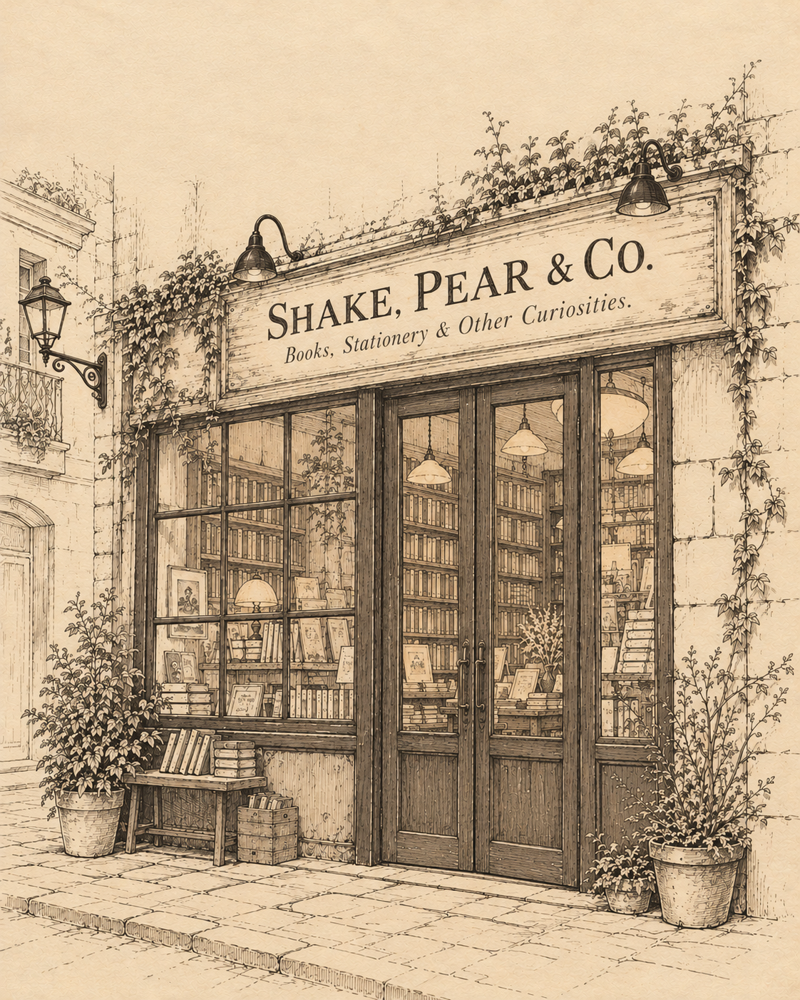

*Not every question gets to be asked.*   
*Not every question will receive an answer.*  
*Some things remain unfinished because the moment to discuss them passes.*  

## White Nights

Summer has a way of overstaying its welcome.

That's what happens when you live on an island barely north of the equator. The heat never really leaves, and the humidity makes sure you don't forget it. Occasionally, the skies open up and rain pours down hard enough to make you think the weather might finally change. Give it twenty minutes, though, and the sun returns, the streets begin to dry, and everything carries on as though nothing happened.

I've lived here long enough to stop expecting anything different. There are rainy seasons, of course, but most days, the distinction between February and August is hardly noticeable. You wake up, check the weather, and dress for summer, because that's what you've been doing practically every day of the year.

That afternoon was no different.

I'd finished work earlier than expected and had a few things to buy before leaving for a short trip later that evening. A notebook was one of them, although I already had several at home. Most contained little more than a date, a few abandoned thoughts, and occasionally a shopping list.

There were at least three stationery shops closer to the office, but I had somewhere else in mind.

An old bookstore on Mistral Street.

*Shake, Pear & Co.*

Yes, that was its actual name.

I used to work there when I was in university. Back then, I spent weekends rearranging shelves, unpacking deliveries, and explaining to customers that no, we didn't have the latest university textbooks, and no, I couldn't order them for tomorrow. Some customers found that difficult to accept, especially the ones who had left their assignments until the last possible moment.

The place belonged to George and Sylvia, an elderly couple who had somehow managed to keep an independent bookstore alive despite rising rents and the fact that fewer people seemed interested in buying actual books.

George was a strange man. He liked old books, classical music, and making sure people treated books properly. I remember watching him demonstrate how to open a paperback without damaging its spine. Sometimes he'd stop customers in the middle of browsing to show them, whether they wanted the demonstration or not. Once, a man tried to explain that he'd already bought the book and could open it however he pleased. George disagreed.

Sylvia was more practical. She handled the money, the suppliers, and, on most days, George.

They made a good team, although I suspected Sylvia did most of the work that actually kept the business running.

I hadn't visited in months, and since I was already nearby, I figured I might as well stop by. Besides, the shop had air-conditioning, which at that particular moment was reason enough.

**SHAKE, PEAR & CO.**

*Books, Stationery & Other Curiosities.*

The sign above the entrance had faded slightly. I pushed open the glass door, and the little bell above it rang. I remembered that sound, along with the smell of paper, wood, a little dust, and coffee that seemed to linger in the shop even when nobody was drinking any.

The layout hadn't changed much. There were still shelves of secondhand novels along the left wall, expensive notebooks near the counter, and an entire section devoted to things nobody really needed but somebody would inevitably buy. A digital wall clock hung behind the counter, alongside a few framed photographs.

Among the curiosities were small globes, music boxes, postcards, miniature buildings, and a porcelain cat wearing glasses.

I remembered that cat. It had been there when I worked at the shop, sitting on the same shelf with its ridiculous little spectacles.

Nobody wanted it back then. Judging by the dust, nobody had changed their mind.

Above the stationery section hung several decorative figures, including a cupid carrying a bow. I'd helped George install them years ago. He'd insisted that the decorations would make the shop more welcoming, and I'd asked him whether a naked child carrying a weapon was really the atmosphere he wanted.

He hadn't appreciated the question.

The cupid remained where we'd placed it, though one of its wings still looked slightly crooked. I had pointed that out when we first installed it, and George had promised to adjust it later.

“Still haven't fixed you, huh?” I muttered.

*“Sorry?”*

I turned and found a young woman behind the counter. She was holding a paperback and wore a dark jacket with a red three-headed dragon embroidered on the chest. Her hair was loosely tied back, with a few strands falling around her face.

“Oh, sorry. I was talking to the decoration.”

She looked toward the cupid, then back at me.

*“Right.”*

“Old acquaintance,” I explained.

She seemed to consider that for a moment before closing her book around a finger.

*“Okay. Can I help you with something?”*

“I'm looking for a notebook.”

*“Over there.”* She pointed toward the shelf behind me.

“Thanks.”

She returned to her book, and I went to examine the notebooks.

There were more choices than I expected, although a surprising number had inspirational quotes printed across their covers. I picked up one with a mountain on it, put it back, and looked at another decorated with a photograph of the ocean.

“Do you have anything without inspirational quotes?” I asked.

She looked up again. *“Sorry?”*

“Notebooks. Without inspirational quotes.”

*“There are plain ones on the bottom shelf.”*

“Ah. Good.”

I crouched to look, but one of the notebooks on the upper shelf caught my attention again.

*“What's wrong with the quotes?”* she asked.

“Nothing, I suppose. I just don't particularly want motivational advice from my stationery.”

*“Then don't buy one with a quote.”*

I picked up the notebook with the mountain on its cover: *The Journey Begins.*

Another declared *Believe in Yourself*, while a third was covered in gold lettering that read *You Are Enough*.

*“That one's nice,”* she said, noticing the last one.

“Twelve dollars just to tell me I'm enough?”

She laughed. *“It's a notebook. You're supposed to write in it, not just read the cover.”*

I eventually chose a dark-blue notebook and brought it to the counter. She set her book aside and scanned the barcode.

*“Twelve fifty.”*

I looked at the notebook, then at the price on the register.

“When did George start charging this much for notebooks?”

She paused before taking my card.

*“Wait, you know George?”*

“Unfortunately.”

She looked surprised, so I explained that I'd worked at the bookstore years ago, back when I was still studying.

*“Oh, really? Well, that explains why you were talking to the cupid earlier.”*

“Yeah. I helped George put those decorations up. He was convinced they'd make the shop more welcoming.”

She finished processing the payment and handed me the receipt. I picked up my notebook. “Thanks.”

*“You're welcome, Batman.”*

I stopped. “Batman?”

She pointed to the logo on my shirt.

“Oh. Right.”

I'd completely forgotten what I was wearing. I looked at her jacket again.

“Thanks, Daenerys.”

She smiled.

“Mother of Dragons?” I continued.

*“Obviously.”*

“Breaker of Chains?”

*“Of course.”*

“Rightful heir to the Iron Throne?”

She looked at me as though she were waiting to see how far I intended to take this. I gave her a small bow.

“Your Grace.”

That finally made her laugh.

*“Much better.”*

“Oh, by the way, I don't think I've introduced myself. I'm James.”

*“Cel.”*

“Cel?”

*“It's short for Celina.”*

“Ah, the woman who turns people to stone when they look into her eyes?”

She frowned slightly. *“I think that's Medusa.”*

“Wait, really? I thought that was someone else.”

*“No, definitely Medusa,”* she said. *“I took a Greek mythology class, so I'm fairly confident about that one.”*

“Well, I'll take your word for it.”

I gave her a small nod and headed toward the reading area at the back of the shop.

The reading area was just as I remembered it, with the same wooden table, three mismatched chairs, and an old globe on a stand near the bookshelves. George had bought the globe long before I started working there, and occasionally he would stop beside it to explain something about the countries whose borders had changed since it was made.

I took a seat by the window and opened the notebook.

I wrote the date. Then I stared at the page.

This was a familiar ritual. I'd buy a notebook, convince myself that I was finally going to organize my life, write the date, and spend the next several minutes trying to think of something worth writing. Sometimes I'd manage a few lines. More often, the notebook would end up in a drawer and remain there until I bought another one.

I was trying to decide whether a to-do list counted as a respectable beginning when somebody pulled out a chair at the opposite end of the table.

It was Celina.

She'd brought her book, a bottle of water, and her phone. Another employee was now behind the register, speaking to a customer about a book order.

Celina placed her things beside her and opened her book.

For a few minutes neither of us said anything. I looked at the date I'd written at the top of the page, trying to think of something to write beneath it. Nothing came to mind.

Eventually, I gave up and started listing the things I still needed to do before my trip. It wasn't what I'd bought the notebook for, but at least I was putting it to use.

While trying to remember what else I needed, I glanced around the reading area and noticed the old globe on its wooden stand near the bookshelves.

“George still has that old thing?”

Celina followed my gaze. *“The globe?”*

“Yeah. I remember getting a ten-minute lecture from George about that thing. Something about how old things have character.”

*“He did something similar last week,”* she said. *“Some customer asked about the typewriter on display, and George started telling him the history of it.”*

“How long did that take?”

*“I don't know. Fifteen minutes, maybe? I had to go help somebody else.”*

“Did the customer actually buy the typewriter?”

Celina chuckled. *“No. I don't think he even wanted to buy it. He was asking how much it cost.”*

I remembered the typewriter she meant, but before I could say anything, she'd returned to her book. I went back to my notebook and continued what I was writing. A little later, I put my pen down and checked my watch. That's when I noticed the phone beside her paperback.

“Wait, is that a Motorola?”

She looked at the phone.

*“Yeah. Why?”*

“I didn't know they still made phones.”

*“Of course they do.”* She picked it up and checked the screen.

“I haven't seen one in years. Does it still have that *Hello Moto* ringtone?”

*“No, I haven't heard that in ages.”*

“Really? I used to hear that everywhere.”

*“I know, but that was a long time ago. I've been thinking about getting a new one, actually. The battery isn't as good as it used to be.”*

We talked about phones for another minute or two. She wasn't particularly keen on spending money on a new one just because the battery was getting worse. I told her I'd probably keep using it until it stopped working entirely.

*“That's probably what I'll end up doing,”* she said.

She put her phone aside and returned to her book while I added a few more things to my list. By the time I finished, I'd remembered most of what I needed for the trip. I closed the notebook and looked toward Celina. She had been reading steadily, occasionally stopping to turn back a page.

The cover showed a narrow European street at night, with old buildings rising on either side and a solitary figure standing beneath a streetlamp. The illustration made the place look almost deserted, as though everyone in the city had gone to sleep except for that one person.

Dostoyevsky's name was printed across the top, although I couldn't make out the title.

“Is that Dostoyevsky?” I asked.

She looked up. *“Yeah. You've read him?”*

“A few of his works. *The Idiot*, *Demons*. I don't recognize that cover, though.”

She turned the paperback around so I could see it properly.

I read the title and recognized it immediately. I'd read a different edition years earlier.

“Oh, I've read that one.”

*“Really? What did you think?”*

“It's been a while. I remember liking it, though. A little sad.”

*“I'm not finished yet, so don't tell me anything.”*

“Don't worry. It's been years. I barely remember the ending anyway.”

She adjusted the book in her hands, keeping a finger between the pages.

*“Do you read much?”* she asked.

“Not as much as I used to. Most of my reading these days is documentation at work, or people explaining why something isn't working.”

*“That sounds boring.”*

“Sometimes. I used to read quite a lot when I was younger. Novels, history, whatever I happened to find interesting.”

*“Oh, what happened?”*

“Nothing dramatic, really. Mostly it's just work. I got used to spending my free time doing other things.”

*“Like what?”*

“Different things. Sometimes I start a project, spend a few weeks on it, and then get distracted by another idea.”

She thought about that for a moment.

*“I have the same problem with my writing sometimes,”* she said. *“I start something and really like it, then halfway through I decide it's terrible.”*

“What kind of things do you write?”

*“Little stories, mostly. Sometimes poems. I guess you could say I'm a frustrated writer.”*

“Well, that makes two of us.”

She smiled. *“Then we're both writers without books.”*

“A writer without books? Isn't that just unemployed?”

She laughed, though she shook her head. *“That's not what I meant.”*

“I know, I know.”

*“Actually, I did have one of my stories published once. There was a literary event, and they put together a collection of stories from different writers. Mine was one of the ones they selected.”*

“Oh, that's pretty cool. So you really are a published writer.”

*“Well, technically. It was just one short story, and there were plenty of other writers in the book.”*

“Still counts. Not everyone gets to see something they've written in print.”

*“I suppose you're right.”*

I thought about asking what the story was called, but she had already opened her book again, and I wasn't sure whether she wanted to keep talking about it.

For a while, we occupied ourselves with our own things. Celina drank some water, read another page, and checked her phone before putting it face down beside the book. At one point, I caught myself reading the same item on my list several times without remembering why I'd written it. I crossed it out, then decided I probably shouldn't have. Eventually, I thought about what she'd said earlier.

“Hey, can I ask you something about your writing?”

She looked up from her book. *“Sure.”*

“Do you ever reread your old stories and feel like changing things?”

*“Sometimes. There are a few things I'd probably change.”*

“Even the one that got published?”

*“Especially that one,”* she said. *“There are things I'd probably write differently now.”*

“Would you ever make a new version of it?”

*“I don't know. Maybe.”*

She took a moment before continuing.

*“I thought about it once, but then I'd probably end up changing other things too. If I kept going back to fix everything I wasn't happy with, I'd never get around to anything new.”*

“That's true.”

*“Besides,”* she added, *“sometimes the things that don't turn out the way you wanted are what make the story interesting.”*

I considered that for a moment. I wasn't entirely sure I agreed, particularly when it came to my own abandoned projects, but I understood what she meant.

Before I could respond, I felt my phone vibrate in my pocket. I took it out and saw a notification reminding me that an order I'd placed the other day was ready for collection. I'd completely forgotten about it, and the collection point was closing soon.

“Ah, shit.”

*“Everything okay?”* Celina asked.

“Yeah, I forgot I needed to pick something up before they close.”

I checked my watch. It was 4:47 in the afternoon, which meant I'd have to hurry if I wanted to make it on time. I stood up and glanced toward the counter. The digital clock behind the counter showed 5:47 AM.

“Hey, Cel, is that clock set to the wrong time?”

She turned to look. 

*“Oh, that one? It's been like that for as long as I've worked here.”*

“It's eleven hours behind. Nobody's thought to change it?”

*“I offered to set it properly once, but George said to leave it as it was. I never bothered asking again.”*

I looked at the clock once more. George had always been fond of keeping strange things around.

“Anyway, I should get going. It was nice talking to you, Cel.”

*“You too, James.”*

“And good luck with your writing.”

*“Thanks. You too.”*

I slipped the notebook into my bag and started toward the entrance.

“Catch you later, Daenerys.”

She shook her head, amused.

*“Bye, Batman.”*

On my way out, I passed the little cupid above the stationery section. Its crooked wing was still exactly as I'd remembered.

Outside, the afternoon heat hadn't let up. I checked the collection address on my phone and started walking toward the station.

## Sunrise

The evening crowd was beginning to arrive at Jurong East MRT station.

Office workers were making their way through the gantry, some walking briskly toward the escalators while others stopped to check their phones or look at the directional signboards. The station was getting busier as more commuters arrived from the surrounding buildings.

I'd collected my parcel earlier, so there wasn't much left to do except get to the airport. I checked the time on my phone, slipped it into my pocket, and made sure I still had my wallet and passport.

My backpack was heavier than I'd expected. I'd packed more clothes than I needed for a short trip, along with a few things I probably wouldn't use. I should have brought a small suitcase, I thought to myself.

I adjusted the straps and made my way toward the eastbound platform.

The next train was arriving in three minutes. Judging by the number of people waiting, I considered taking the one after it. I wasn't in any particular hurry, and I'd rather avoid a crowded train if I could.

I found a quieter section of the platform and set my bag down.

A little farther along, someone was standing near one of the pillars, looking at her phone. She wore a dark jacket, with a paperback tucked beneath one arm and a small bag hanging from her shoulder.

I recognized the jacket first.

Then the book.

Then the person holding both.

For a moment, I wondered whether she'd noticed me. She seemed occupied with her phone, occasionally looking up at the arrival display before returning her attention to her phone.

I picked up my bag and walked over.

“Excuse me. Is this the platform for Winterfell?”

She looked up. For a second, she seemed confused. Then she recognized me.

*“Hey, you!”* 

She looked from my face to the bag over my shoulder.

*“Wait. What are you doing here?”*

“I'm taking the train.”

*“I mean, what are you doing here? Didn't you leave the bookstore a while ago?”*

“Had to collect something. What about you? I thought you'd still be at work.”

*“I finished early today. Jenny's handling the rest of the shift and closing the store tonight.”* Celina put her phone away and adjusted the paperback beneath her arm.

*“Wait, are you stalking me now?”* she added with a teasing smile.

“Sorry?”

*“First you show up at the bookstore, and now you're suddenly at the same train station as me?”*

“I'm pretty sure I was here first. And I didn't even know you worked at the bookstore until you started talking to me.”

*“That's exactly what a stalker would say.”*

I gave her an incredulous look. “What was I supposed to do, leave the station when I saw you?”

She laughed. *“I'm joking, James!”*

The arrival display board changed from three minutes to two. A few people nearby moved closer to the platform doors, despite there being nowhere useful to move until the train arrived.

Celina looked toward the tracks. *“So, where are you heading?”*

“Changi Airport. What about you?”

*“Oh, I'm getting off at Tanah Merah.”* She looked at my backpack, then back at me. *“Are you going on holiday?”*

“Yeah, taking some time off for the Mid-Autumn Festival.”

*“Oh, nice! How long will you be away?”*

“Until next Friday. I figured I'd give myself the weekend to rest before going back to work next Monday.”

*“Ah, that makes sense.”* 

She nodded and returned her attention to the arrival board.

The train arrived shortly afterward. Through the windows, I could see people standing shoulder to shoulder near the doors, although there appeared to be some space farther inside.

When the doors opened, only two or three passengers alighted, while a much larger crowd was waiting to board. Celina moved forward with the others but stopped when she saw how crowded the carriage was.

*“Actually, I think I'll wait for the next one. This one's too crowded.”*

I was about to board, but after seeing how crowded it was, I decided it wasn't worth squeezing in with my backpack.

“Yeah, I think I'll wait for the next one too. I'm not in a hurry anyway.”

*“Hopefully the next one's less crowded.”*

She stepped away from the doors, and I followed. We watched as more passengers squeezed into the carriage until the doors finally closed and the train pulled away, leaving several people behind on the platform.

A man nearby complained about the crowd before taking out his phone and watching a video.

*“So, what do you actually do for work?”* Celina asked.

“I work on software projects, mostly designing and building systems and making sure everything works together.”

*“Oh, really? Do you enjoy it?”*

“Yeah, I do. I write code, but not as much as I used to. These days, I spend more time reviewing other people's work and trying to prevent problems before they happen.”

*“That sounds like a lot of responsibility.”*

“Sometimes. Especially when something goes wrong and everyone wants to know what happened. There's a running joke at work that nobody wants to see me at the office because it usually means something serious has happened and I've had to come down to sort it out.”

*“That's not a very good sign, is it?”*

“Yeah, I'm like the Grim Reaper. Nobody really wants to see me around the office.”

*“Well, shit. I was going to say you're more like Sherlock.”*

“Sherlock?”

*“Yeah! You know, investigating things and figuring out what went wrong.”*

“I guess that makes more sense.”

For a while, we watched people moving along the platform. Two children were arguing over who would sit beside the window, while their mother explained that there probably wouldn't be any seats. The younger one didn't seem particularly concerned about this information.

Celina watched them for a moment.

*“I used to do that with my sister.”*

“Fight over the window?”

*“Oh, we fought over everything. The window, where we sat, even who got to press the lift button. Sometimes we'd argue over things neither of us really wanted. My mother used to get so annoyed with us.”*

“Did you usually win?”

*“Of course. I was a very persuasive kid.”*

“I'm sure your sister would tell a different story.”

*“Probably. When you're growing up in a house full of girls, there's always somebody to argue with. We get along much better now, though.”*

The next train arrived with considerably fewer passengers than the previous one.

We boarded the last carriage and made our way toward the end, where there was enough space to stand without getting in anybody's way. I set my backpack on the floor beside me while Celina stood near the window. As the train pulled away from Jurong East, the buildings outside slowly began moving past us. We could see part of the tracks stretching behind the train before they disappeared around a bend.

*“You know, I had a student ask me something the other day, and I didn't really know how to answer,”* Celina said.

“Oh? What was it?”

*“We were doing a writing exercise, and I asked them to write a short description of themselves. Nothing complicated, just something to get them writing. One of them started complaining about his name because he didn't like it.”*

“What was his name?”

*“Bartholomew Joseph.”*

“That's not so bad. I used to know a guy named Bartholomew, but we all called him Bart.”

*“Well, your friend's surname isn't Simpson.”*

I almost laughed when I realized. “Wait, as in Bartholomew Joseph Simpson?”

*“Exactly!”*

“Oh, man, that's unfortunate.”

*“I know! And the worst part is that his parents knew exactly what they were doing. He told me his father thought it was hilarious.”*

“Seriously? Poor kid. I can imagine what happens whenever somebody calls his name during attendance.”

*“That's exactly what he complained about. But then he asked me something I hadn't really thought about before. Why do parents get to choose their children's names when they're the ones who have to live with them?”*

“Well, it's a little difficult to ask someone what they'd like to be called before they're born.”

*“That's pretty much what I told him! But then another student suggested that parents could just give their children temporary names until they were old enough to choose their own. And suddenly everybody had an opinion about it. Some thought it was a wonderful idea, while others said they'd never agree to the names their parents had chosen.”*

“What happened to the writing exercise?”

*“Oh, we eventually got back to it. But we spent almost fifteen minutes discussing names.”*

“Wait, hold on, I didn't know you were teaching. I thought you were just working at the bookstore.”

*“I am. But I also help mentor some secondary-school students with their English and writing. It's something I do through a programme at the university.”*

“Oh, you're still studying?”

*“Yeah, English Literature. I've still got a while before I graduate.”*

“And how's that going? Between school, mentoring, and the bookstore. Doesn't it get pretty busy?”

*“Sometimes, but it's manageable. I'm only at the bookstore part-time, and I don't have mentoring sessions every day. I really enjoy working with them, though. Especially when they come up with things I never would've thought of myself.”*

“Like the temporary names?”

*“Exactly!”*

“I'm guessing Bart was particularly enthusiastic about that discussion.”

*“Oh, he was! And the funny thing is, I couldn't really blame him. I started thinking about my own name afterward because my parents almost gave me a different one.”*

“Really? What was it?”

*“Celestina.”*

“Celestina? I actually think it sounds nice. Has a certain ring to it, you know.”

*“I know! I like it too. My mother liked it because it comes from a Latin word meaning heavenly. She thought it was a beautiful name, but my father wasn't so convinced. They went back and forth about it for a while, but neither wanted to change their mind.”*

“And so they finally agreed on Celina?”

*“Yes. María Celina. Most people just call me Celina or Cel, though.”*

The train slowed as it approached the next station. A few passengers stood up, including a man who'd been reading something on his tablet since we boarded. When the doors opened, several people got off while a few others boarded. A woman carrying two shopping bags came in and stopped near the opposite doors, and we moved slightly to give her more room.

*“Actually, my father was the one who suggested Celina in the end. My mother wasn't entirely convinced at first, but she eventually agreed.”*

“Does your father usually get his way?”

*“Not really. My mother can be pretty stubborn when she wants to be.”*

“Well, at least they managed to agree on something eventually.”

*“Oh, they disagree about plenty of things. But they're usually good about finding something they can both live with.”*

“I guess that's something you learn after raising kids for a while. You can't exactly disagree about everything.”

*“You'd think so. Although they can be frustrating sometimes, especially when they're giving advice.”*

“How so?”

*“Well, it's difficult to explain, you know, because they're actually very supportive. They've always encouraged me to do things I enjoy, things that I love, but sometimes I feel like they already have an idea of what I should be doing with my life.”*

I shrugged. “But isn't that just normal for any parent?”

She continued, now talking a little more freely.

*“Of course. But, see, that's what makes it annoying. They're not telling me I can't do something. They'll listen to my ideas, they'll tell me they're wonderful, and then start suggesting ways to turn them into something more practical.”*

“What do you mean by practical?”

*“When I was younger, I told my father I wanted to become a writer. He thought that was great, but then he started talking about being a teacher because at least I'd have a proper career. Another time, I told him I wanted to become a photographer, and suddenly he was suggesting that I should study something related to media or advertising.”*

“I mean, they're not bad suggestions, are they?”

*“No, they're not! And I know he meant well, but that's the thing. I wasn't asking him to help me figure out what to do with my life. Sometimes I just wanted to talk about something I was excited about and have him listen, you know?”*

“Have you tried explaining that to him?”

She pointed at me, laughing. *“See? You're doing something similar now.”* 

“What do you mean?” 

*“You're already trying to figure out what I should do about it, and I wasn't even asking for help!”*

“Oh, shit. You're right. I didn't even realize I was doing that.”

*“That's what I mean! And I know you're only trying to help. It's the same with my father. I love him, and I know he means well, but sometimes I don't need a plan. Sometimes I just want to say something out loud and see how it sounds.”*

“Yeah, I get that. It's like when somebody tells you about a problem, and you immediately start trying to fix it, even though maybe they just wanted to complain for five minutes. Although if somebody comes to me with a problem, I'm probably going to try to fix it.”

*“That's different. You're literally being paid to fix things.”*

“Well, shit, you are right about that one.”

*“I don't want to make them sound unreasonable, though. Sometimes I think I wouldn't have tried half the things I've done if they hadn't encouraged me, you know.”*

We continued talking about some of the things she'd wanted to do when she was younger, and I shared a few stories of my own. Eventually, we got onto the subject of adulthood and how differently we'd imagined it when we were children.

“I used to think adults knew what they were doing,” I told her. “You know, that by the time you reached a certain age, you'd have figured most things out.”

*“And you don't think that anymore?”*

“Not after I started working. I've sat and talked with people who seemed incredibly confident about what we should do. They'd explain everything, we'd all agree, and then two weeks later we'd discover it was a terrible idea.”

*“Do they ever admit it was a bad idea?”*

“Sometimes. Other times we'd have another meeting to discuss why circumstances had changed.”

She laughed. *“That sounds exhausting.”*

“It can be. But you get used to it after a while. I mean, you're making decisions with whatever information you have at the time, right? Sometimes you get things wrong, and half the time, you're just hoping somebody remembers why you made the decision in the first place.”

*“Does that happen often?”*

“Oh, it does, more often than I'd like.”

The train went underground, and the buildings outside disappeared from view. As it grew darker beyond the glass, our reflections became clearer in the window.

Celina turned toward me.

*“Anyway, can I ask you something?”*

“Sure.”

*“How good are you at noticing things?”*

I turned away from the window. “What do you mean?”

*“You know, little details. Things that most people don't pay attention to.”*

“I'd say I'm pretty good at it. Why?”

She surveyed the carriage. *“Okay, I want to try something with you.”*

I raised an eyebrow. “Ohhh-kay... What are you planning?”

*“Nothing! It's just a little experiment I came across a while ago. I want to see if it works on you. I'm going to give you five seconds to look around the carriage and remember a few things.”*

“Okay, I'll bite. What am I looking for?”

*“I want you to remember as many red things as you can. Five seconds. Go!”*

I immediately started looking around the carriage. There was a woman near the doors carrying a red handbag, an advertisement above the seats with red lettering, and a water bottle sticking out of someone's backpack. I spotted a little boy wearing a red shirt, and then my eyes fell on the dragon embroidered on Celina's jacket.

“Does the dragon crest on your jacket count?”

*“Yes! Keep looking!”*

I turned toward the opposite end of the carriage, trying to find a few more things before she stopped me.

*“Time!”*

I looked back at her. “Okay, got them.”

She looked rather pleased with herself.

*“Good. Now, without looking around again, tell me everything you saw that was green.”*

I blinked, trying to figure out whether I'd heard her correctly.

“Green?”

*“Yes!”* She was already struggling to keep a straight face.

“Wait, what? You told me to look for red!”

*“I did.”*

“Well, shit, why are you asking me about green things then?”

*“I wanted to see if you'd remember any!”*

“How? I wasn't even looking for them!”

*“That's the point!”*

She burst out laughing, loud enough that a passenger nearby briefly looked in our direction.

*“Come on, Sherlock. I thought you'd be better at this.”*

“Oh, please. You told me to look for red things, so I looked for red things.”

*“I know, I know. But that's what I wanted to show you. You were so busy looking for red things that you probably missed half of what was right in front of you.”*

“Yeah, but you can't pay attention to everything at once.”

*“Of course not! But that's what I find interesting. We were both looking around the same carriage, and somehow we noticed completely different things.”*

“Yeah, I get it. But you totally set me up.”

I turned toward the rest of the carriage to see what I'd missed. There was a green shopping bag near the opposite doors, some green lettering on an advertisement, a small cartoon character on the cover of a book someone was reading, and even a green sticker on the train door that I'd been looking straight past. The whole damn carriage was practically covered in green, and I'd somehow missed all of it.

“Well, shit. There's green everywhere. Even my backpack is a shade of green.”

*“See? I told you!”*

Her eyes went to the bag on the floor beside me.

*“How long are you going to be away again? You look like you've packed for a month.”*

“Until next Friday. Now that you pointed it out, I think I might've overplanned things a little.”

*“Do you always pack this much when you travel?”*

“Not really. Depends where I'm going.”

*“Have you travelled much?”*

“A bit. I've been to different places, some for holidays, others for work.”

*“Really? Where have you been?”*

I told her that most of my travels had been around Asia. I'd spent quite a bit of time in Japan, visited Malaysia more times than I could remember, and once had a work assignment in Guam that I didn't particularly enjoy. Taiwan was still my favorite, though.

We exchanged a few stories, including one about a trip where I'd tried to squeeze too many things into a single day. I'd planned everything, but I ended up spending more time travelling between places than actually seeing them. By the time I got back to the hotel, I was too tired to do anything except order food and sleep.

*“Wait, I thought you said you liked planning everything?”*

“Oh, I do, but that's where I went wrong. I planned too much. I had everything worked out, but I didn't think about how tired I'd be after walking around all day.”

*“I know what you mean. We've had a few trips that didn't go as planned either.”*

She went on to tell me about some of the trips she'd taken with her family. Once, they'd arrived at a place just as it was closing, and her sister had complained about it for the rest of the afternoon. Celina seemed to remember these little mishaps as fondly as the places themselves.

At one point, she mentioned a trip through two countries in South America.

*“There was this valley we went to, and I remember the wind being really strong. It was carrying all this dust around, and somehow it kept getting into everything. My clothes, my shoes, even my bag. I don't think we could've kept it out if we'd tried.”*

“Was it like a sandstorm?”

*“Not really. I mean, it was dusty, but we could still walk around and everything. It was just so dry and windy. And there were these huge rock formations all around us. I remember thinking the whole place looked strange, but in a really nice way.”*

“Did you get to see much of it with all that dust blowing around?”

*“Oh, yeah! We walked around for quite a while. We went to this one place called San Juan, and it was beautiful, actually. I don't know how to explain it, but something about the place felt like home.”*

“Really? Even with all that dust?”

*“Yes, even with all the dust!”*

By then, the train had been underground for some time. Every few minutes, we stopped at another station, where some passengers got off and others boarded.

Our conversation continued through the stops, and I gradually stopped paying much attention to the station announcements.

Then, somewhere after Lavender station, the train returned above ground.

The darkness beyond the window gave way to the evening sky, and the buildings came back into view. Our reflections faded against the glass as the tracks carried us above the roads and toward the next station.

Celina glanced outside for a moment, then turned back toward me.

*“You know, I actually prefer travelling with other people. Even when we end up arguing about where to go.”*

“Really? I don't mind travelling alone. Sometimes it's easier when you don't have to agree with anyone about what to do.”

*“That's true. But I think it's more fun when you have someone to share the experience with. Especially when something goes wrong.”*

“Until that person starts blaming you for everything.”

*“Well, that's why you don't travel with people like that, Sherlock!”*

A few minutes later, the train began slowing down. I looked outside, expecting another station, but we were still some distance from the next platform.

The train came to a stop.

An announcement came over the speakers, explaining that we were waiting for the train ahead to clear.

Celina glanced toward the doors, then took the paperback from beneath her arm and held it in front of her. I noticed that several pages had been folded at the corners.

“Do you always do that to your books?”

*“Do what?”*

“Fold the corners.”

She looked at the book, then back at me. *“You don't like it?”*

“I mean, there are things called bookmarks.”

*“And there are corners.”*

She opened the paperback to one of the folded pages and showed me a passage she'd underlined. The margins were full of handwritten notes.

*“Look, I do much worse things than folding corners.”*

“You write in them too?”

*“Sometimes. If there's something I like, or something I disagree with. I don't do it to every book, though.”*

“Doesn't it bother you when you read it again?”

*“Why would it?”*

“I don't know. Seeing your old notes everywhere.”

*“That's actually what I like about it. Sometimes I'll read something I wrote a few years ago and wonder what I was thinking. Or I'll find a note I completely forgot writing.”*

“Have you ever read one and disagreed with yourself?”

*“Oh, plenty of times! Sometimes I can't even figure out why I thought a particular sentence was important.”*

“I think I'd be embarrassed reading some of the things I wrote a few years ago.”

The train began moving again, slowly at first, before picking up speed. Celina adjusted her footing as we continued toward the next station.

*“I think it's normal to look back at something you wrote and cringe a little. I do that all the time.”*

“You know, I've been meaning to ask about that story you mentioned at the bookstore. What was it about?”

*“Oh, it was part of an anthology.”* She paused, trying to decide how to explain it. *“It's about a girl and her mother. Well, that's part of it. It's difficult to explain without telling you the whole story.”*

“Is it long?”

*“Not really. Why?”*

“Can I read it?”

She looked at me for a second. 

*“Right now?”*

## The Things That Remained

Naomi almost walked past the station exit because she remembered it being farther away.

As a child, she'd thought the station was enormous. She remembered the wooden benches along the platform, the clock above the ticket windows, and the newspaper stand where her father always stopped before they boarded the train. He insisted on arriving early, then complained about waiting. Whenever Naomi asked why they couldn't leave home later, he told her trains didn't wait for people who preferred sleeping.

The clock was gone, and much of the station had been renovated. Naomi stood with her suitcase, trying to remember which side the newspaper stand had been on. She was fairly sure it was beside the stairs, where a vending machine stood now.

She'd moved to another city nearly eleven years earlier. Her visits home were brief, and she rarely went anywhere beyond her mother's house. This time she'd taken several days off work to help her mother pack for a move to an apartment.

On the walk home, Naomi found that the bakery where she bought sweet bread after school had become a pharmacy. The cinema was closed, its old sign still hanging above the entrance, and several shops in the covered arcade had their metal shutters down. She remembered those shutters rattling every evening. One shopkeeper used to bang his shutter three times before it would stay shut, which always irritated her father.

At the railway crossing, she waited for a train. The warning bell sounded familiar, but the little shop beside the tracks, where her father sometimes bought newspapers, was gone. After the barriers lifted, she took a wrong turn at an intersection she'd crossed almost every day as a child.

Even the hill to her family's neighborhood seemed less steep.

Her mother met her at the gate, immediately complained that she should have taken a taxi, then took the suitcase despite Naomi's protests. The house looked tired. Its tiled roof had darkened, paint peeled around the windows, and the gate still needed lifting to close. Her father had promised to fix it every spring. He died, and nobody had bothered since.

Cardboard boxes occupied the living room, though the cupboards were still full. Her mother had packed dishes and a surprising number of towels.

“Why do you have four rice cookers?” Naomi asked.

“Two don't work.”

“Then why keep them?”

“They might be repaired.”

Naomi put the broken ones beside a box marked for disposal. While she was in the kitchen, her mother returned one to the cupboard.

They spent the afternoon disagreeing about what to keep. Naomi wanted the dining table because it had belonged to her grandparents. Her mother pointed out that neither of them had room for it. They agreed to discuss it later, as they did with most things.

After dinner, Naomi walked through the shuttered arcade to the park where she'd met friends after school. The swings had changed, and the large tree near the entrance was gone. She remembered a boy climbing too high one summer and refusing to come down until his mother arrived. She could still picture him crying while everyone promised not to laugh, but his name escaped her.

A man walked past with a dog that inspected every tree. Somewhere beyond the houses, Naomi heard a train. She stayed until the cold sent her home.

Her mother had prepared bedding in Naomi's old bedroom. Through the window she could see the blank wall of a building that hadn't existed when she was young. She lay awake listening to her mother moving about downstairs.

Then the earthquake struck before dawn.

Naomi woke to a noise like something enormous hitting the house from below. The floor lurched sideways before she could sit up. Her wardrobe slammed against the wall, books fell, and a ceiling fixture shattered near her feet. She tried to reach the door, but another violent movement threw her back onto the bedding. Beneath the breaking glass and cracking wood came a roar that seemed to rise through the floorboards.

Her mother was shouting her name. Naomi covered her head and tried to stay still until the shaking stopped.

In the darkness, she found her slippers among scattered books and reached the hallway. Her mother stood near the stairs with a flashlight, its beam wandering over cracked plaster and fallen picture frames.

“Get your coat,” her mother said.

“Wait. I can't find it. Where is it?”

“I don't know. Just get something.”

Outside, roof tiles and masonry covered the street. Neighbors stood in their nightclothes, calling into houses that hadn't emptied. Part of the house next door had collapsed, and a man was pulling timber away from its entrance. Naomi knew his face but couldn't remember his name. She joined him while her mother searched for their other neighbors.

They could hear a woman answering from inside. More people arrived with flashlights and tools, and they worked at an opening between fallen beams. An aftershock sent everyone stumbling back. For a moment they stood looking at the wreckage, unwilling to approach it. Then the woman called again, and the man picked up his metal bar.

By daylight they had brought her out. She could barely stand, and her husband remained trapped. Someone went looking for rescuers while the others continued working.

Smoke rose beyond the railway tracks. Naomi heard sirens, although debris made the streets difficult to pass. She had known earthquakes before, but never one that left an entire neighborhood looking as though it had been pulled apart.

Reports spread slowly. Railway lines and roads were damaged, telephones barely worked, and fires were moving through neighborhoods of wooden houses. With water pipes broken, even fighting the fires was difficult. Naomi's mother wanted to retrieve their documents, but neither of them dared enter the cracked house.

They walked to a nearby school, where teachers were recording the names of families arriving with blankets, bags, or nothing at all. The classrooms were crowded, and people gathered around a battery-powered radio. An elderly man at the entrance asked whether trains would run the next morning. Nobody answered. A little later, he asked again.

That evening, Naomi helped distribute water. There wasn't enough for all the people inside, and a woman protested when told to take only one container because she had three children. Someone accused the volunteers of keeping supplies for themselves. Naomi had no answer; she didn't know when another delivery would come.

Her mother helped prepare food, and Naomi carried bowls to the classrooms. They worked until the pot was almost empty, then shared what was left. At night, every aftershock woke someone, and the cold crept in beneath the classroom doors.

Over the following days, Naomi hauled water, cleaned rooms, and listened to people worrying aloud. A shopkeeper who'd lost the business his father opened complained about the lack of help, then volunteered to accompany an injured neighbor to a clinic. Students carried supplies to people unable to leave their shelters, while others helped repair damaged homes.

Naomi recognized a few of the volunteers from years ago, although she couldn't remember ever speaking to them. They talked about neighbors she no longer knew and shops that had changed owners several times since she'd left. Sometimes she recognized a name, only to discover that the person had moved away or died. She found herself listening more than talking, occasionally asking what had happened to someone she remembered.

Naomi's sister arrived several days later after a difficult journey along damaged roads. Their mother cried when she saw her and then scolded her for coming without a warmer coat.

Together they returned to their street. The cinema had partially collapsed, and the pharmacy in the old bakery had lost its windows. In the arcade, bent shutters hung above broken glass. Naomi recognized the shop whose owner had struggled with his shutter every evening. Debris blocked the entrance, and she couldn't tell what had happened to him.

The railway crossing was silent. Its barriers were down despite the absence of trains, and the tracks were visibly damaged. Naomi remembered waiting there beside her father, wishing the bell would stop so they could get home for dinner.

Their own house stood, though the gate hung from its hinges and the stone lantern lay broken in the garden. A crack ran down the kitchen wall. Her mother touched the splintered gate and stayed there until Naomi's sister reminded her they weren't allowed inside.

On the way back, Naomi stopped at the park. Volunteers had put up tables for water and food, and she helped unload bags of rice. A girl sitting beside the tables was writing names on pieces of cardboard. When she made a mistake, she rubbed at it with an eraser until the surface began to tear.

“You can use another piece,” Naomi said.

The girl flipped it over, inspected the blank side, and shook her head.

“This one's still good.”

She began writing again, pressing the pencil hard against the cardboard.

Before Naomi left, one of the volunteers asked her to collect a bag of rice for the school kitchen. She agreed, though she still had a few things to do.

Later, Naomi found her mother and sister at the school discussing whether the house could be repaired and what the insurance might cover. She'd already extended her leave from work. Her return ticket was useless, and there were still documents to recover, people to contact, and decisions none of them wanted to make.

Her mother interrupted to ask whether she'd eaten.

“Not since breakfast.”

“There's some rice left. Come on.”

They gathered their things and walked toward the room where food was being prepared. Her sister complained about the cold, and their mother reminded her yet again that she'd warned her to bring a warmer coat.

They were nearly there when Naomi stopped.

“Oh, I forgot the rice.”

Her sister stared at her. “The rice we're going to eat?”

“No, the bag they asked me to collect for tomorrow.”

She sighed and handed Naomi the blanket she'd been carrying. They walked back toward the distribution point.

*Hyōgo, Japan, January 1995*

## Another Day 

*“So, what do you think?”*

“Well, shit. I don't know how you do it.”

*“Do what?”*

“You just left me speechless.”

*“Really?”* Celina was still watching me.

“Yeah. Although I have to admit, I wasn't expecting an earthquake when I started reading. You told me it was about a girl and her mother.”

*“It is about a girl and her mother!”*

“Yeah, but you left out the part where half the neighborhood falls apart.”

She laughed. *“I told you it was difficult to explain without giving away the whole story!”*

“You could've at least hinted that something big was going to happen.”

*“What's the fun in that? Would you still have read it if I'd told you everything?”*

“Yes, I would've read it anyway. I was already curious when you told me you'd been published.”

*“Oh, so you just wanted to see if I could actually write?”*

“I mean, for all I knew, you could've made the whole thing up.” 

*“James!”*

“I'm kidding! You did a good job. Seriously.”

She smiled a little wider while holding her phone.

................

WIP

## Letters

WIP

Singpost -> Correo AR, called but no EN -> emaild -> DHL -> unk street, unk route addr

well, tried my best, but afaik, CPT-SJ or RVDV-SJ  
well, no luck, cant send. ok  

focus: ch + pr + jms

## Sunset 

WIP

## Elsewhere

WIP

## Bookmarked

WIP

## Midnight

WIP

----------------------------------------------

<!-- February comes every year.  
But the same February doesn't.

A bookstore might still exist somewhere else,  
but it won't be the same place.

Two people might talk again,  
but they won't necessarily return to what they were before. -->